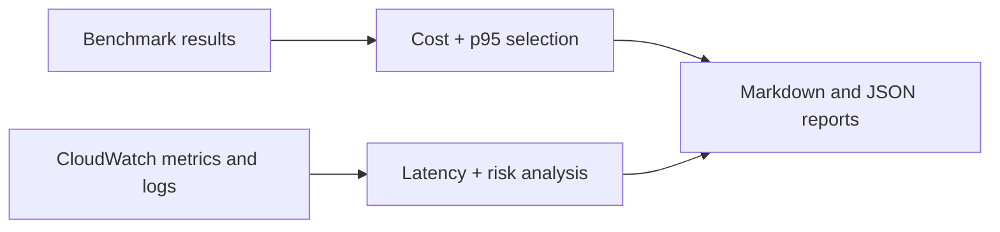

<div align="center">
  
  <h1>LambdaOpt</h1>
  <p><strong>Find the lowest-cost AWS Lambda configuration that meets your p95 latency target.</strong></p>
  <p><a href="#quickstart"><strong>Run the local demo</strong></a> · <a href="#architecture">Architecture</a> · <a href="docs/usage.md">CLI guide</a></p>
</div>

[](https://github.com/Mike-Animal-Counseling/aws-lambda-slo-optimizer/actions/workflows/ci.yml) · Beta · Python 3.11+

A smaller Lambda can cost less per invocation and still be the wrong choice if it misses your latency target. LambdaOpt compares memory and architecture candidates using benchmark data, then shows the p95, p99, estimated cost, and reason behind its recommendation.

## Features

- **Benchmark candidates.** Start with synthetic data, load existing benchmark results, or invoke explicitly mapped test functions.
- **Compare cost and latency.** Filter candidates by p95 target and errors, then rank the passing configurations by estimated monthly cost.
- **Investigate a deployed function.** Inspect CloudWatch latency, errors, and throttles. Include logs to check cold-start signals.
- **Share the evidence.** Export Markdown and JSON reports with recommendations, measurements, and rejected candidates. Charts are optional.

## Example recommendation

Two rows from the synthetic demo report for a **500 ms p95 target** and 1 million monthly requests.

| Candidate | p95 | p99 | Est. monthly cost | Result |
| --- | ---: | ---: | ---: | --- |
| 512 MB arm64 | 633.1 ms | 692.9 ms | `$3.91` | Misses target |
| 1024 MB arm64 | 357.9 ms | 479.4 ms | `$4.38` | Recommended |

## Architecture



The optimizer works on typed benchmark data and runs locally. The CloudWatch workflow produces a separate diagnostic report. See the [module boundaries and report formats](docs/architecture.md).

## Quickstart

Requires Python 3.11+. On Windows, use the [PowerShell setup](docs/installation.md#from-source).

```bash
git clone https://github.com/Mike-Animal-Counseling/aws-lambda-slo-optimizer.git
cd aws-lambda-slo-optimizer
python -m venv .venv
source .venv/bin/activate
python -m pip install .
lambdaopt start
```

The demo needs no AWS credentials. Open `reports/start/optimization_report.md` for the full candidate comparison.

For AWS, start with the [sandbox walkthrough](docs/smoke-test.md). CloudWatch analysis reads metrics and optional logs. Benchmarking can invoke explicitly selected functions, so use test targets. LambdaOpt leaves Lambda configuration unchanged.

## Documentation

- [CLI workflows](docs/usage.md) and [IAM permissions](docs/iam-permissions.md)
- [Recommendation logic](docs/design.md) and [cost model](docs/cost-model.md)
- [Safety](docs/safety.md) and [contributing](CONTRIBUTING.md)

[MIT license](LICENSE)
